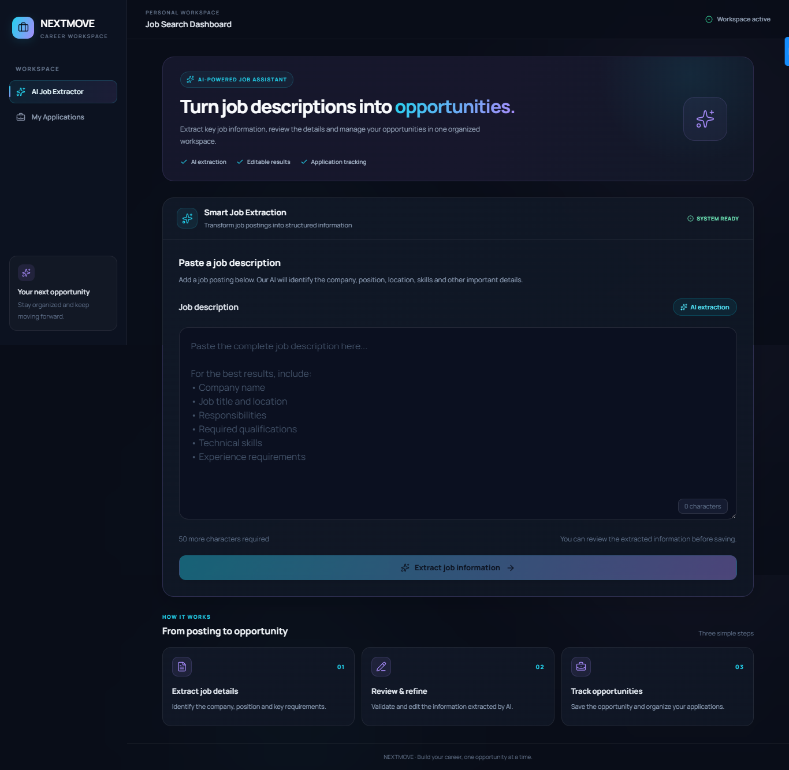
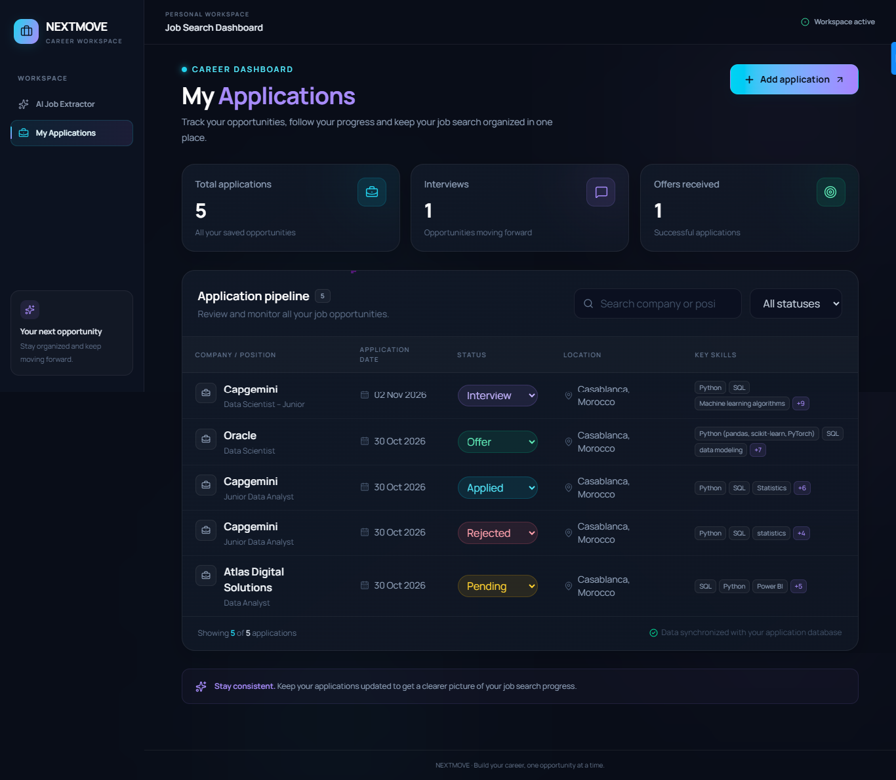
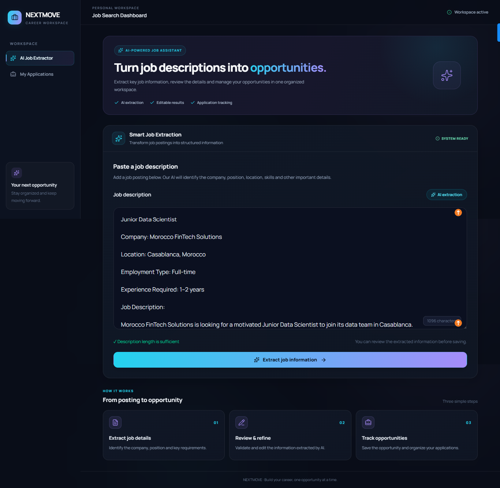
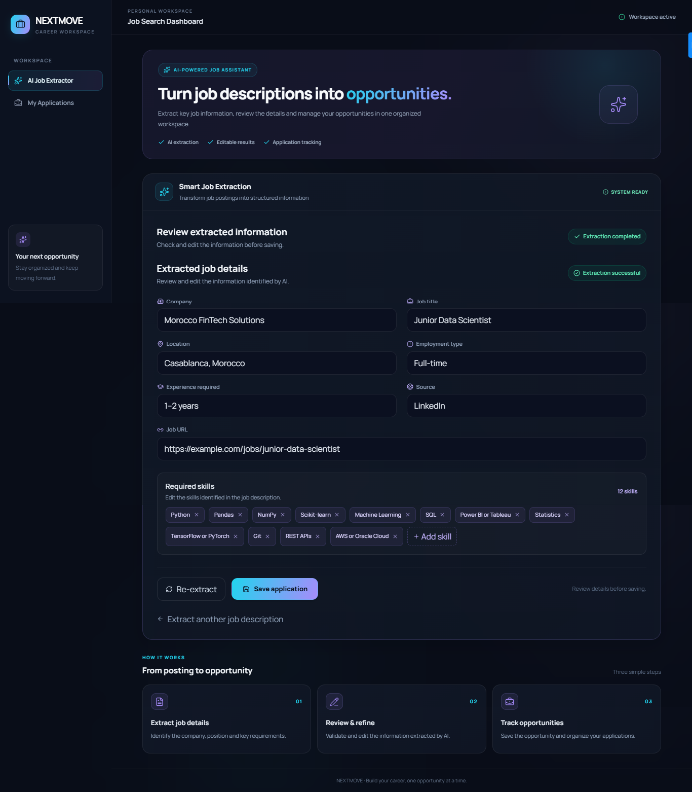
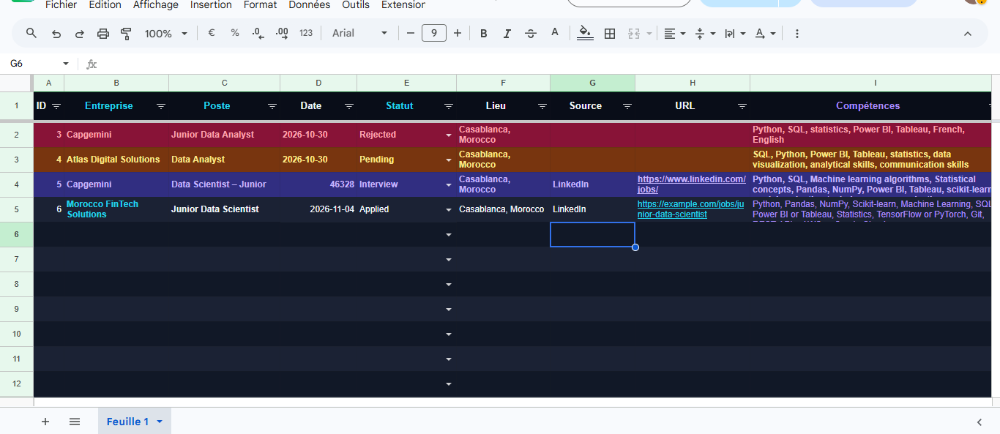

# 🚀 NEXTMOVE — Job Application Tracker

**Organize your applications. Track your progress. Move forward.**

NEXTMOVE is a job application tracking platform designed to help job seekers organize their opportunities, manage their recruitment progress, and keep all their application information in one place.

Built with React, TypeScript, FastAPI, and SQLite, NEXTMOVE combines AI-powered job information extraction, application management, and Google Sheets synchronization into one centralized workspace.

---

## 📸 Screenshots

Explore the main features and workflow of NEXTMOVE.

### 🏠 Application Dashboard



Overview of saved applications, recruitment statistics, search, and filtering.

### 📋 Applications Management



Manage saved job opportunities, review application details, and update recruitment statuses directly from the applications table.

### 🤖 AI Job Description Extraction



Paste a job description and extract structured information using AI.

### ✅ Extraction Review & Validation



Review and edit the extracted company, position, location, experience, employment type, and required skills before saving the application.

### 📊 Google Sheets Synchronization



Keep application records synchronized with Google Sheets, including updates to recruitment statuses.

---

## ✨ Features

### 🤖 AI-Powered Job Information Extraction
- Extract structured information from pasted job descriptions.
- Automatically identify company names and job titles.
- Extract location, employment type, and required experience.
- Identify technical and professional skills.
- Detect job URLs and recruitment platforms when available.
- Review and edit extracted information before saving.

### ✅ Extraction Review & Validation
- Display extracted information in structured fields.
- Allow users to review and correct information.
- Validate job details before creating an application.
- Save the validated information to the application database.

### 📋 Application Management
- Save and organize job applications.
- View all applications in a centralized table.
- Track company, position, location, and application date.
- Store required skills, job URLs, and personal notes.
- Search and filter applications.

### 📊 Recruitment Progress Tracking
- Update application statuses directly from the applications table.
- Monitor recruitment progress through:
  - 📨 Applied
  - 🎤 Interview
  - 🎉 Offer
  - ❌ Rejected
  - ⏳ Pending
  - 🚫 Withdrawn
- View key statistics, including total applications, interviews, and offers.

### 🔄 Google Sheets Integration
- Synchronize newly saved applications with Google Sheets.
- Automatically update corresponding application statuses.
- Maintain SQLite as the primary data source.
- Use Google Sheets as an additional view for application tracking.

---

## 🛠️ Tech Stack

| Layer | Technologies |
|---|---|
| Frontend | React, TypeScript, Vite |
| Styling | Tailwind CSS |
| Backend | Python, FastAPI |
| Database | SQLite, SQLAlchemy |
| Data Validation | Pydantic |
| AI Integration | Google Gemini, Groq |
| External Integration | Google Sheets API |
| Development Tools | Git, GitHub, VS Code |

---

## 🏗️ Project Architecture

```text
job-tracker/
│
├── frontend/
│   └── React + TypeScript
│       ├── Job Extraction Interface
│       ├── Extraction Validation
│       ├── Applications Dashboard
│       └── API Integration
│
├── backend/
│   └── FastAPI
│       ├── API Routes
│       ├── Database Models
│       ├── Pydantic Schemas
│       └── Services
│           ├── LLM Extraction
│           └── Google Sheets Integration
│
├── docs/
│   └── screenshots/
│
├── .gitignore
├── LICENSE
└── README.md
```

### 🔄 Application Workflow

```text
       Job Description
              |
              v
       React Frontend
              |
              v
       FastAPI Backend
              |
              v
        LLM Extraction
        Gemini / Groq
              |
              v
      Structured Job Data
              |
              v
     Review & Validation
              |
              v
      Save Application
              |
        +-----+------+
        |            |
        v            v
   SQLite DB    Google Sheets
   (Primary)    (Synchronization)
```

---

## 🚀 Getting Started

### 📌 Prerequisites

Make sure you have installed:

- Python 3.10 or later
- Node.js and npm
- Git

### 1️⃣ Clone the Repository

```bash
git clone https://github.com/Hanasoummar/nextmove.git
cd job-tracker
```

### 2️⃣ Backend Setup

Navigate to the backend directory:

```bash
cd backend
```

Create a virtual environment:

```powershell
python -m venv jobt_env
.\jobt_env\Scripts\Activate.ps1
```

Install dependencies:

```bash
pip install -r requirements.txt
```

Create a `.env` file inside the backend directory:

```env
GEMINI_API_KEY=your_gemini_api_key
GROQ_API_KEY=your_groq_api_key
GOOGLE_SHEET_ID=your_google_sheet_id
```

Configure your Google service account credentials locally if you want to enable Google Sheets synchronization.

Start the backend:

```bash
python -m uvicorn app.main:app --reload --port 8000
```

Backend URL:

`http://127.0.0.1:8000`

Interactive API documentation:

`http://127.0.0.1:8000/docs`

### 3️⃣ Frontend Setup

Open another terminal and navigate to the frontend directory:

```bash
cd frontend
```

Install dependencies:

```bash
npm install
```

Start the frontend:

```bash
npm run dev
```

Open the local URL displayed in your terminal.

---

## 🧪 Test the Application

You can test NEXTMOVE using the following fictional job description.

### Example: Junior Data Scientist — Atlas Finance

**Company:** Atlas Finance

**Position:** Junior Data Scientist

**Location:** Casablanca, Morocco

**Employment Type:** Full-time

**Experience:** 0–2 years

**Job Description:**

We are looking for a motivated Junior Data Scientist to join our Data & Analytics team at Atlas Finance.

You will work with business and technical teams to transform raw data into meaningful insights and develop machine learning solutions that support business decision-making.

**Responsibilities:**

- Collect, clean, and preprocess structured and unstructured datasets.
- Perform exploratory data analysis and identify relevant patterns.
- Develop and evaluate machine learning models.
- Build data visualization dashboards and analytical reports.
- Collaborate with software engineers to integrate data science solutions.
- Communicate findings and recommendations to business stakeholders.

**Required Skills:**

- Strong Python programming skills.
- Knowledge of Pandas, NumPy, and Scikit-learn.
- Understanding of machine learning algorithms.
- SQL and relational databases.
- Experience with data visualization tools such as Power BI.
- Good analytical and problem-solving skills.
- Knowledge of Git and REST APIs is an advantage.

**Experience:** 0–2 years of experience or relevant academic projects.

**Job URL:** https://example.com/jobs/junior-data-scientist

**Source:** LinkedIn

> This is a fictional job description created for testing purposes. The URL is illustrative and does not represent a real job vacancy.

---

## 🔐 Security

- Store API keys and environment variables in local `.env` files.
- Never commit Google service account credentials.
- Keep local databases and generated files out of version control.
- Use `.env.example` to document required environment variables without exposing secrets.

---

## 📌 Current Project Status

**Version 1 — Core Job Application Management**

The current version focuses on:

- AI-powered job description extraction.
- Extraction review and validation.
- Structured application management.
- Recruitment status tracking.
- Search and filtering.
- Google Sheets synchronization.

---

## 🔮 Future Improvements

NEXTMOVE is an evolving project. Planned improvements include:

- [ ] User authentication and personal workspaces.
- [ ] Advanced analytics dashboard.
- [ ] Application reminders and follow-up notifications.
- [ ] Automatic job discovery from selected job platforms.
- [ ] AI-powered job description analysis.
- [ ] CV-to-job matching and skill gap analysis.
- [ ] Personalized job recommendations.
- [ ] Deployment with a production-ready database.

---

## 📄 License

This project is licensed under the MIT License. See the [LICENSE](LICENSE) file for details.

---

## 👩‍💻 Author

Developed as a personal project to explore full-stack development, AI integration, data management, and practical automation.

---

<p align="center">
  <strong>🚀 NEXTMOVE</strong><br/>
  <em>Organize your applications. Track your progress. Move forward.</em>
</p>